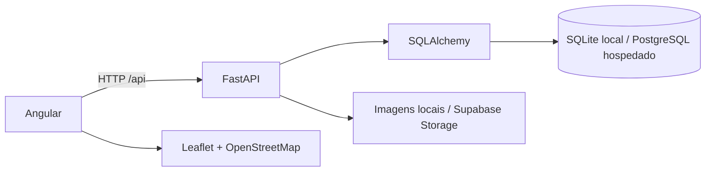

# VerdePerto 🌱

**Compartilhe o que a natureza oferece.**

Plataforma comunitária para doar, trocar e vender produtos naturais cultivados localmente. Quem tem excedentes publica uma oferta; quem procura descobre na lista ou no mapa e combina a retirada pelo chat.

Projeto acadêmico de Engenharia de Software, com integração real entre Angular, FastAPI e banco relacional. O fluxo central é **PUBLICAR → ENCONTRAR → COMBINAR**.

## Apresentação no GitHub Pages, sem servidor

Existe também um **modo de demonstração interativa**, inteiramente no navegador:
cadastro e login de teste, criação/edição/exclusão de ofertas com fotos, favoritos,
perfil, busca, mapa e chat com respostas simuladas. Os dados ficam neste navegador;
alterações não são compartilhadas entre visitantes. Use apenas informações fictícias.

Para experimentar sem iniciar Python ou banco de dados:

```bash
cd frontend
npm ci
npm run start:demo
```

Abra **http://localhost:4300** e use **Usar conta de teste**. Ana, João e Maria já
estão disponíveis; **Recomeçar demonstração** restaura os exemplos para outra apresentação.

Para publicar, envie as alterações para o GitHub, selecione **Settings → Pages →
Source: GitHub Actions** e execute **Actions → Publicar demonstração do VerdePerto →
Run workflow**. O endereço esperado após a publicação é
`https://devcota.github.io/verde-perto/`; confirme a URL no resultado do workflow.
Seu computador não precisa permanecer ligado. Veja o [passo a passo e os limites da demonstração](docs/demo-github-pages.md).

As seções seguintes descrevem a versão completa, com servidor e banco de dados.

## O que está implementado

- Cadastro, login, logout e recuperação de sessão ao recarregar a página.
- Perfil público com avatar por inicial, bairro/cidade, descrição e histórico de publicações; edição e alteração de senha.
- Anúncios de doação, troca e venda, com foto, quantidade, unidade, categoria e região aproximada.
- Edição e exclusão restritas ao proprietário; status disponível, reservado, indisponível e concluído.
- Homepage pública, busca, filtros reais, paginação e ordenação por proximidade.
- Mapa Leaflet/OpenStreetMap com seleção manual de região, geolocalização opcional e ofertas agrupadas por região.
- Favoritos persistentes e chat entre duas pessoas, associado à oferta, com busca incremental de mensagens.
- Upload local validado; integração configurável com Supabase Storage para produção.
- Seed idempotente, contagens reais do banco, scripts de execução, testes e documentação.

Avaliações, denúncias, curadoria/cadastro de pontos comunitários, notificações e recuperação de senha por e-mail ficam fora do MVP. Não há pagamento integrado; as pessoas combinam os detalhes diretamente. Existe a estrutura de pontos comunitários e um endpoint de leitura, sem pontos inventados.

## Tecnologias e arquitetura

| Parte | Tecnologia | Papel |
|---|---|---|
| Interface | Angular 22, TypeScript, componentes standalone | Telas, rotas, formulários e Signals |
| Estilo | Tailwind CSS 4, CSS, DM Sans local e Lucide | Layout responsivo, tipografia e ícones |
| Mapa | Leaflet + OpenStreetMap | Descoberta geográfica aproximada |
| API | Python 3, FastAPI, Pydantic, Uvicorn | Validação e regras de negócio |
| Persistência | SQLAlchemy 2 + SQLite/PostgreSQL | Dados relacionais e controle de integridade |
| Autenticação | Argon2 + sessões em banco | Senhas protegidas e cookie HttpOnly |
| Qualidade | pytest e Playwright | API, permissões e jornadas no navegador |



Sem Redis, filas, microsserviços ou WebSockets. O chat faz polling incremental a cada quatro segundos e pausa quando a aba não está visível.

## Execução rápida

Pré-requisitos: Git, Python **3.11+** com `venv`, Node.js **22.x (a partir de 22.22.3), 24.x (a partir de 24.15) ou 26.x**, e npm. A conexão à internet é necessária para a primeira instalação e para carregar os mapas; anúncios e fotos locais não dependem de CDN.

| Sistema | Inicializador | Estado de verificação |
|---|---|---|
| Linux | `scripts/dev.sh` | Testado com Node 26 e Python 3.14 |
| macOS | `scripts/dev.sh` | Preparado, ainda não validado nesse sistema |
| Windows | `scripts/dev.ps1` | Preparado para PowerShell, ainda não validado nesse sistema |

Linux/macOS, na raiz do repositório:

```bash
bash scripts/dev.sh --seed
bash scripts/dev.sh
```

Windows, no PowerShell, na raiz do repositório:

```powershell
.\scripts\dev.ps1 --seed
.\scripts\dev.ps1
```

Os scripts criam o ambiente virtual, instalam dependências quando necessário, copiam `backend/.env.example` para `backend/.env`, criam as tabelas e iniciam os dois serviços. O seed é **explícito**; omita o primeiro comando para começar com banco vazio. Ctrl+C encerra os processos. Portas ocupadas e erros de inicialização são informados no terminal.

### Preparação do Windows

Instale o Git, uma versão compatível do Node.js (que inclui npm) e o Python com o launcher `py` ou a opção de adicionar Python ao `PATH`. Abra um novo PowerShell após as instalações e confira:

```powershell
py --version
node --version
npm.cmd --version
```

Se o launcher `py` não estiver disponível, confira `python --version`; o inicializador também aceita esse comando. Não é necessário ativar o ambiente virtual para usar `dev.ps1`.

Se o PowerShell bloquear a execução do arquivo `.ps1`, execute o inicializador Python diretamente, a partir da raiz do projeto:

```powershell
py -3 scripts/dev.py --seed
py -3 scripts/dev.py
```

Nesse caso, use `python` no lugar de `py -3` se essa for a instalação disponível. Mantenha o terminal aberto enquanto utiliza o sistema e acesse http://localhost:4200.

### Executar em outro computador

1. Envie o código completo ao repositório com commit/push antes de cloná-lo no outro computador, ou transfira uma cópia dos arquivos-fonte.
2. Instale os pré-requisitos acima no computador de destino.
3. Transfira os fontes sem `backend/.venv`, `frontend/node_modules`, builds ou caches; os scripts recriam as dependências no destino. Ambientes virtuais não devem ser reaproveitados entre computadores ou sistemas operacionais.
4. Execute o inicializador correspondente ao sistema, sempre a partir da raiz do projeto. Use `--seed` para preparar os dados fictícios de apresentação.

O banco `backend/verdeperto.db`, as fotos de `backend/uploads/` e o arquivo `backend/.env` são locais e não acompanham o Git. Para levar seus próprios cadastros e fotos, encerre o sistema no computador de origem e transfira separadamente o banco e a pasta de uploads, preservando esses caminhos. Revise a configuração `.env` no destino; o inicializador cria uma configuração local padrão se ela não existir.

As portas **4200** e **8000** precisam estar livres. Executar o projeto localmente em outro computador é diferente de disponibilizá-lo pela internet: acesso externo requer o deploy descrito em [docs/deploy.md](docs/deploy.md) ou a configuração de um túnel.

### Terminal Fish

Os comandos `bash scripts/dev.sh --seed` e `bash scripts/dev.sh` também funcionam no Fish. Não é necessário ativar o ambiente virtual: o inicializador usa o Python de `backend/.venv` diretamente.

Se quiser ativá-lo para executar comandos Python manualmente, use o arquivo específico do Fish, a partir da raiz do projeto:

```fish
source backend/.venv/bin/activate.fish
```

O arquivo `activate`, sem extensão, é destinado a Bash/Zsh e produz erro de sintaxe no Fish. Mantenha o terminal com `bash scripts/dev.sh` aberto enquanto usa a aplicação; Ctrl+C encerra os serviços.

| Serviço | Endereço |
|---|---|
| Aplicação | http://localhost:4200 |
| API e banco (health check) | http://localhost:8000/api/health |
| Swagger | http://localhost:8000/docs |

### Instalação manual

```bash
cd backend
python3 -m venv .venv
.venv/bin/python -m pip install -r requirements.txt
cp .env.example .env
.venv/bin/python -m app.seed
.venv/bin/python -m uvicorn app.main:app --reload --port 8000
```

Em outro terminal:

```bash
cd frontend
npm ci
npm start
```

No Windows, a sequência manual equivalente para o backend, no PowerShell, é:

```powershell
cd backend
py -3 -m venv .venv
.\.venv\Scripts\python.exe -m pip install -r requirements.txt
Copy-Item .env.example .env
.\.venv\Scripts\python.exe -m app.seed
.\.venv\Scripts\python.exe -m uvicorn app.main:app --reload --port 8000
```

Em outro PowerShell, partindo da raiz do projeto:

```powershell
cd frontend
npm.cmd ci
npm.cmd start
```

O proxy Angular encaminha `/api` para a porta 8000; o browser usa cookies da própria origem.

## Contas de demonstração

Após o seed:

| Pessoa fictícia | E-mail | Senha |
|---|---|---|
| Ana Oliveira | `ana@verdeperto.example` | `DemoVerde123!` |
| João Santos | `joao@verdeperto.example` | `DemoVerde123!` |
| Maria Costa | `maria@verdeperto.example` | `DemoVerde123!` |

Os domínios `.example` são fictícios e não recebem e-mails. A demonstração contém ofertas de todas as modalidades, diferentes estados, favoritos e uma conversa entre Ana e João. Os pontos são regiões aproximadas de Contagem/MG. Usuários, descrições e ofertas são sintéticos; fotos são ilustrativas. O seed pode ser repetido sem duplicar seus registros.

Use navegador normal e janela anônima para conversar entre duas contas. O roteiro completo está em [docs/fluxos.md](docs/fluxos.md).

## Configuração

A API lê **`backend/.env`**, ou variáveis de ambiente do processo. O `.env.example` da raiz mostra a variável usada pelo proxy de hospedagem; não substitui o arquivo do backend.

| Variável | Valor local / finalidade |
|---|---|
| `DATABASE_URL` | `sqlite:///./verdeperto.db`; em produção, conexão PostgreSQL com SSL |
| `ENVIRONMENT` | `development` local; `production` ativa cookie Secure e exige storage persistente para upload |
| `CORS_ORIGINS` | Lista JSON de origens autorizadas, sem `*` com credenciais |
| `UPLOAD_DIR` | `./uploads`, relativo ao diretório do backend |
| `SESSION_DAYS` | Expiração da sessão, padrão 7 dias |
| `SUPABASE_URL` | URL do projeto de armazenamento em produção |
| `SUPABASE_SERVICE_ROLE_KEY` | Segredo somente do servidor para upload |
| `STORAGE_BUCKET` | Bucket público de imagens, padrão `offers` |
| `API_ORIGIN` | Apenas na Pages Function: URL HTTPS da API hospedada |
| `ALLOW_DEMO_SEED` | Somente `true` permite seed explícito em produção; não habilitar por padrão |

O PostgreSQL usa `psycopg`; strings `postgres://` e `postgresql://` são normalizadas pelo backend. Nunca coloque chaves ou conexões secretas no frontend.

## Banco e imagens

Entidades: User, Session, Listing, Favorite, Conversation, Message e CommunityPoint. Favoritos e conversas possuem restrições contra duplicação. Anúncios excluídos deixam de ser públicos e preservam o histórico da conversa. Veja [modelo de dados](docs/modelo-dados.md).

SQLite é salvo em `backend/verdeperto.db`. Uploads ficam em `backend/uploads/`. Esses arquivos são locais e não entram no Git; faça backup se precisar conservar a demonstração. `create_all` cria tabelas, mas não migra esquemas existentes: mudanças futuras precisam de migração planejada.

JPG, PNG e WebP são aceitos até 5 MB. O servidor valida o conteúdo, limita dimensões, reencodifica em JPEG e remove EXIF/GPS. Em produção, usa o bucket configurado do Supabase. Sem storage persistente configurado, o upload em produção retorna erro em vez de salvar fotos em disco temporário. As imagens de demonstração já estão no repositório; origens estão em `frontend/public/assets/sources.json`.

## Testes

Backend, na pasta `backend`:

```bash
.venv/bin/python -m pytest -q
```

Inclui cadastro/login, sessão e logout, validações, autorização de edição/exclusão, disponibilidade, localização segura nos endpoints e no banco, favoritos, conversas privadas sem duplicação, mensagens incrementais, filtros, alteração de senha, upload e jornada de doação.

Frontend, na pasta `frontend`:

```bash
npm run build
npx playwright install chromium
npm run test:e2e
```

Antes dos testes de navegador, execute o seed. Playwright inicia API e frontend se não estiverem ativos. Os testes exercitam mapa, filtros, falha de API, telas responsivas, cadastro, upload, publicação, favoritos, conversa entre contas, atualização/conclusão, perfil e recuperação de sessão. Use um banco local de demonstração: os testes de navegador criam contas e ofertas fictícias. Capturas de revisão são locais e ignoradas pelo Git.

Resultados e limites efetivamente verificados estão em [docs/verificacao.md](docs/verificacao.md).

## Segurança e privacidade

- Senhas usam Argon2; o banco guarda apenas hash de tokens de sessão.
- Cookies são HttpOnly, SameSite=Lax e Secure em produção. Logout e alteração de senha revogam sessões.
- A API verifica proprietário e participantes; o frontend não é uma barreira de autorização.
- Escritas de origens não autorizadas são recusadas. A hospedagem mantém API e interface na mesma origem por proxy.
- Apenas campos públicos explícitos são retornados; perfis públicos não incluem e-mail, hashes ou sessões.
- Coordenadas de ofertas são arredondadas a duas casas decimais antes da persistência (célula de aproximadamente 1 km nesta região). O navegador também reduz a precisão antes das consultas. Não há endereço completo nem coluna privada com coordenadas exatas.
- No Supabase, não exponha as tabelas pela Data API: desabilite a exposição ou habilite RLS sem políticas públicas. A aplicação acessa dados exclusivamente pelo backend.
- `.agents/`, `.codex/`, `.opencode/`, `.impeccable/`, contextos de IA, `.env`, bancos, uploads, caches e dependências estão ignorados. A aplicação executa sem essas ferramentas.

## Publicação futura

Configuração preparada para Angular no Cloudflare Pages, API no Render e PostgreSQL/Storage no Supabase. `render.yaml`, a Pages Function e o fallback SPA acompanham o projeto. Criação das contas, segredos, domínio e publicação dependem do responsável.

Consulte [docs/deploy.md](docs/deploy.md) para passos, variáveis, armazenamento persistente e limites dos planos verificados nas fontes oficiais. A publicação real e a integração com credenciais externas não foram realizadas nesta entrega.

## Estrutura

```text
frontend/
  src/app/          telas, contratos, cliente HTTP e sessão
  src/styles.css   identidade e responsividade
  public/assets/   fotos, fontes via build, logo e fallback
  functions/api/   proxy para hospedagem
  tests/           jornadas Playwright
backend/
  app/             API, schemas, modelos, configuração e seed
  tests/           testes pytest
  .env.example
  requirements.txt
docs/              arquitetura, requisitos, dados, casos, fluxos e deploy
scripts/           inicialização multiplataforma
render.yaml
```

## Capturas e equipe

Capturas reais da aplicação com o seed de demonstração: [início no desktop](docs/screenshots/inicio-desktop.png), [início no celular](docs/screenshots/inicio-mobile.png) e [mapa no celular](docs/screenshots/mapa-mobile.png). A revisão também verificou detalhes, publicação e chat nos dois tamanhos de tela.

O PDF acadêmico de referência não foi disponibilizado neste workspace. Nomes de integrantes, orientador e instituição não foram presumidos; devem ser preenchidos pela equipe responsável.

## Estado da entrega

MVP implementado, com persistência e testes locais. Hospedagem e serviços externos estão preparados e documentados, pendentes das contas e credenciais do responsável. Recursos secundários estão identificados em [requisitos](docs/requisitos.md).
