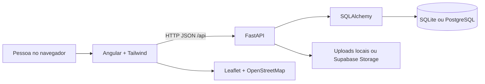

# Arquitetura

O VerdePerto é uma aplicação web acadêmica com três partes. O Angular apresenta as telas; a API FastAPI valida as regras e autorizações; o SQLAlchemy persiste os registros em SQLite local ou PostgreSQL na hospedagem.

- Componentes standalone e rotas carregadas sob demanda mantêm o frontend organizado.
- `api.ts` concentra HTTP, sessão e feedback; `data.ts` contém contratos e terminologia.
- `models.py` define as entidades; `schemas.py` valida as entradas; `main.py` reúne as rotas, sem camadas artificiais.
- A sessão usa cookie HttpOnly, token aleatório e hash do token no banco, com expiração. A aplicação não armazena token no localStorage.
- O chat consulta novas mensagens a cada quatro segundos enquanto a aba está visível. A consulta incremental usa o último ID recebido.
- O proxy local e a Pages Function em produção mantêm `/api` no domínio do frontend, evitando dependência de cookies de terceiros.

## Decisões

SQLite permite executar sem instalar servidor de banco. `DATABASE_URL` troca o driver para PostgreSQL. As tabelas são criadas no início pelo SQLAlchemy; alterações futuras de esquema exigem uma migração planejada. Não há Redis, filas nem WebSockets.

O backend é a autoridade sobre proprietário, participantes, preço, quantidade e coordenadas. A interface repete apenas validações que ajudam a pessoa a preencher o formulário.
