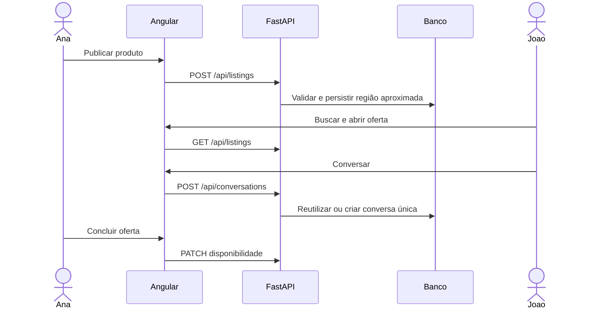

# Roteiro de apresentação

Execute `bash scripts/dev.sh --seed` e depois `bash scripts/dev.sh`. Abra duas sessões de navegador independentes (normal e anônima) para simular pessoas diferentes.

## A — Doação

1. Ana entra com `ana@verdeperto.example`, senha `DemoVerde123!`.
2. Publica “Limões do quintal”, 20 unidades, doação e região aproximada.
3. João entra com `joao@verdeperto.example`, mesma senha, e busca o anúncio.
4. João abre o detalhe e conversa com Ana.
5. Os dois combinam retirada em ponto público.
6. Ana abre Meus anúncios e atualiza a quantidade para 12.
7. Ao terminar, define zero unidades ou status concluído.

## B — Troca

Ana publica mudas, escolhe Troca e descreve o que deseja receber. João filtra por Mudas e plantas, salva a oferta e inicia uma conversa. Favoritos e histórico continuam presentes após recarregar a página.

## C — Mapa

Um visitante abre Mapa, escolhe a região manualmente ou autoriza a localização. O navegador reduz a precisão antes da consulta; a API só devolve áreas aproximadas. Clicar no marcador abre a oferta. Negar geolocalização não impede a navegação.

Os dados do seed são fictícios. Para demonstrar cadastro, crie outra conta com e-mail válido e senha de pelo menos oito caracteres.
