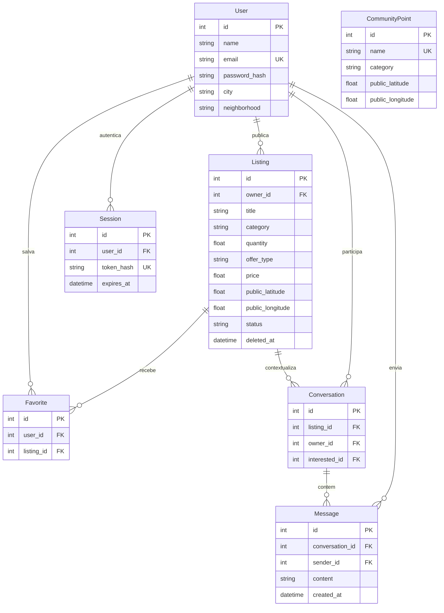

# Modelo de dados

Favoritos são únicos por usuário e anúncio. Conversas são únicas por anúncio e interessado; o anunciante é determinado pelo anúncio. Quantidade e preço não podem ser negativos. E-mail e hash do token são únicos. Há índices nos filtros e relacionamentos mais usados.

Anúncios são excluídos logicamente: deixam as listagens e os favoritos, mas as conversas conservam seu contexto. As coordenadas públicas são as únicas coordenadas do anúncio; não existe coluna com endereço ou coordenada residencial precisa.

SQLite: `backend/verdeperto.db`. PostgreSQL: configurar `DATABASE_URL`. O seed não é uma migração e não deve ser usado para atualizar esquemas.
